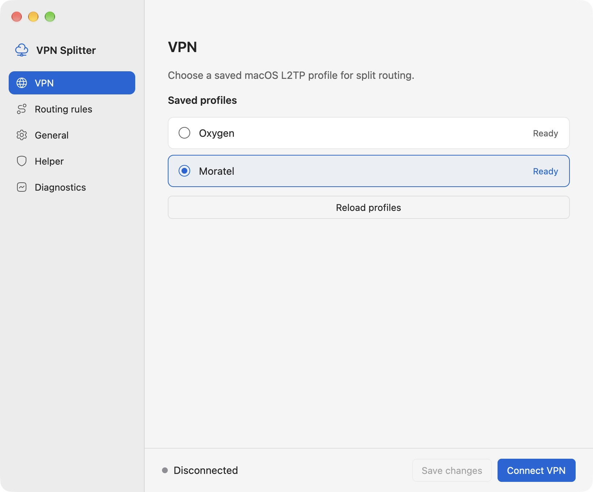
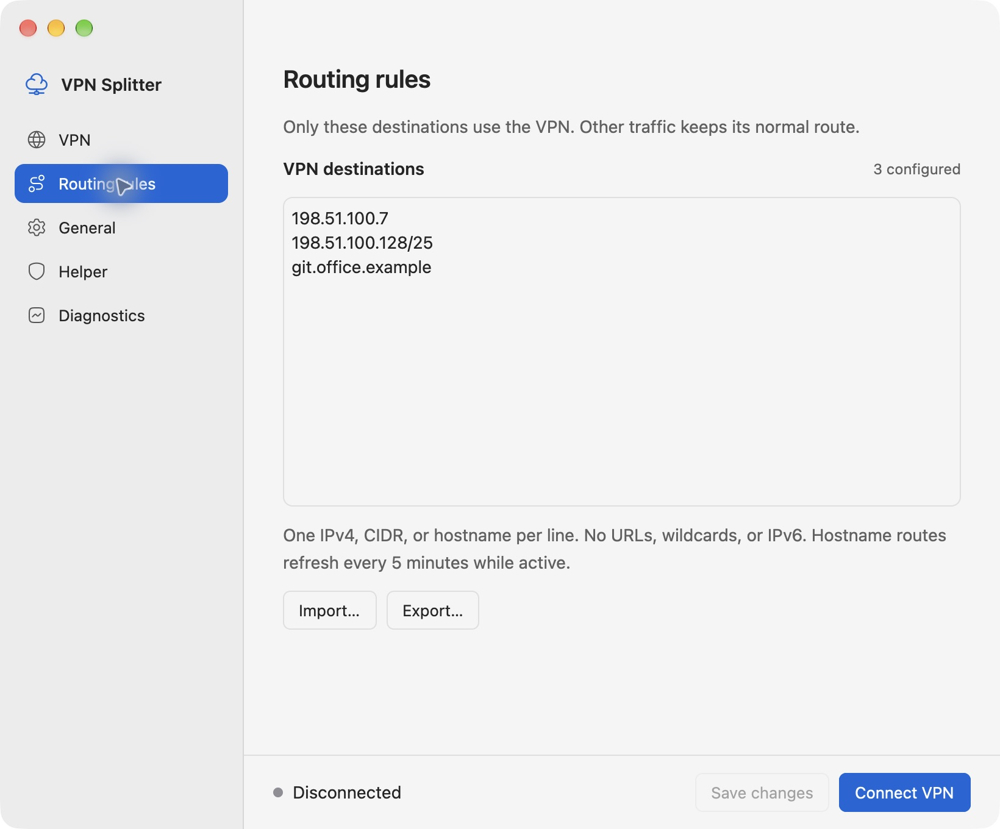
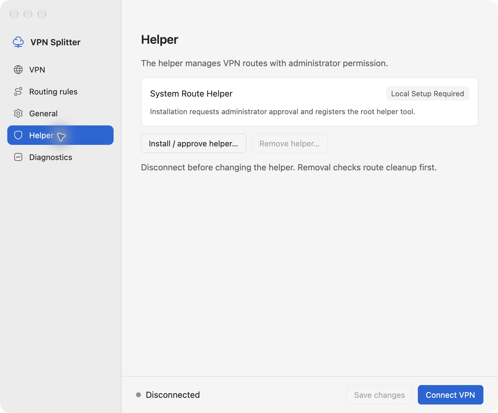

# VPN Splitter

[English](README.md) | [Bahasa Indonesia](README.id.md)

Send office IPv4 traffic through your saved L2TP VPN while keeping public internet
on Wi-Fi or Ethernet. The Rust desktop app uses GPUI and lives in the macOS menu
bar. You can manage the VPN connection and routing rules from Settings.

Real app screenshots below use sample destinations in an isolated configuration. Office IPs and hostnames are not shown.



## Platform support

| Platform | Status |
| --- | --- |
| macOS | Local desktop app and privileged route helper; tested on Apple Silicon. The bundle requires macOS 14 or later. |
| Windows | Binaries can be built. VPN connection management and the route helper are not implemented. |

IPv6 routing, full URLs, and wildcard destinations such as `*.office.example`
are unsupported. Add each hostname you need; subdomains are not discovered
automatically. See [validation notes](docs/desktop-validation.md) for measured
results and remaining checks.

## Build on macOS

Install Xcode with its Command Line Tools, Rust, and GNU Make. The desktop app
has been built with Rust 1.97.1. Start from the repository root:

```sh
git clone https://github.com/Candratama/vpn-splitter.git
cd vpn-splitter
make macos
open "target/release/VPN Splitter.app"
```

`make macos` builds and signs the local app. Building or opening it does not
install the privileged helper. An Apple Developer account is not required for
the default local build, which uses ad hoc signing and is not notarized.

For developer signing, set `VPN_SPLITTER_SIGN_IDENTITY` in your local environment
before building. Packaging does not upload or notarize the app.

## Install and connect

1. Add an L2TP VPN profile in macOS System Settings and disable **Send all traffic**.
2. Open Settings from the app's menu bar icon, then open the **Helper** section.
3. Choose **Install / approve helper...** and approve the macOS administrator
   dialog. Enter your password only in that dialog.
4. The local build is installed under
   `/Library/PrivilegedHelperTools/VPN Splitter.app`. The preview quits and the
   installed app opens automatically.
5. In **VPN**, select your saved profile. In **Routing rules**, enter or import
   office destinations, then choose **Save changes**.
6. Choose **Connect VPN**. Check that routing becomes active before accessing
   office servers. Use **Disconnect VPN** when finished.

Destination lists accept one IPv4 address, CIDR, or hostname per line:

```text
198.51.100.7
198.51.100.128/25
git.office.example
```

These are documentation examples. Replace them with your own destinations.
Hostnames must resolve to IPv4 before their routes can be applied. The app shows
VPN connection and routing status separately. Quit cleans up app-owned routes
and disconnects a VPN connection started by the app.



## Update or remove the helper

To update, disconnect and quit the installed app, build a new preview with
`make macos`, open it, and choose **Install / approve helper...**. The update
requires administrator approval and stops if owned-route cleanup fails.

To remove the helper, disconnect first, then choose **Remove helper...** in
**Helper**. Removal unloads the service and checks route cleanup. If cleanup
fails, it retains the service files and recovery journal for retry. It preserves
the installed app, saved VPN profiles, credentials, and user configuration.



## Build commands

Run `make` or `make help` to list the commands.

| Command | Result |
| --- | --- |
| `make build` | Release binaries for the active Rust toolchain in `target/release/`. |
| `make macos` | Signed local bundle at `target/release/VPN Splitter.app`. Requires macOS. |
| `make windows` | MinGW Windows binaries in `target/release/windows/`. Requires Bash. |
| `make test` | Rust and shell regression tests. Requires Bash. |
| `make clean` | Removes Cargo build outputs. |

For Windows cross-compilation, install a MinGW-w64 toolchain providing
`x86_64-w64-mingw32-gcc`, then run:

```sh
rustup target add x86_64-pc-windows-gnu
make windows
```

On Windows with GNU Make and native Rust build tools installed, `make build`
uses the active toolchain and writes `.exe` files to `target/release/`. Windows
builds currently do not provide working VPN management.

Without Make, run `bash scripts/package-macos.sh` or
`bash scripts/build-windows.sh` directly. For a native binary build, run
`cargo build --release --locked -p vpn-splitter-desktop -p vpn-splitter-helper`.

## CLI for macOS

The standalone shell script works without building the desktop app. Connect
your VPN first, then prepare a private destination list:

```sh
cp config.example.txt config.txt
# Edit config.txt with your office destinations before continuing.
./vpn-splitter.sh status
DRY_RUN=1 ./vpn-splitter.sh apply
sudo -v
./vpn-splitter.sh apply
./vpn-splitter.sh clear
```

The CLI preserves the VPN default route and adds two more specific internet
routes through Wi-Fi or Ethernet. Office routes use the VPN. Existing IPv4 DNS
paths are preserved; system DNS settings and IPv6 routing are not changed.

The script records only routes it creates. Failed apply triggers rollback;
failed cleanup retains state for retry. Repeated apply is a no-op while active.
After editing destinations, reconnecting, or changing networks, run `clear`
followed by `apply`. `DRY_RUN=1` works for both commands without changing routes.

## Local data and diagnostics

The desktop stores its configuration in
`~/Library/Application Support/VPN Splitter/config.json`. It does not import the
CLI's `config.txt` automatically. Use **Routing rules** to import destinations.

Keep office IPs, hostnames, passwords, and inventories local. The repository
ignores CLI configuration, audit reports, credentials, logs, and local state.
Review files before committing; never force-add private configuration.
Diagnostics are redacted by default. Review any export before sharing it.

## Development

`make test` runs the Rust suite and shell tests. The shell tests mock OS commands
and do not change live routes. Build details and remaining qualification work
are documented here:

- [Architecture](docs/desktop-architecture.md)
- [Validation and limitations](docs/desktop-validation.md)
- [Implementation plan](docs/superpowers/plans/2026-10-15-gpui-desktop.md)
- [Icon attribution](crates/desktop/assets/HUGEICONS-LICENSE.md)
